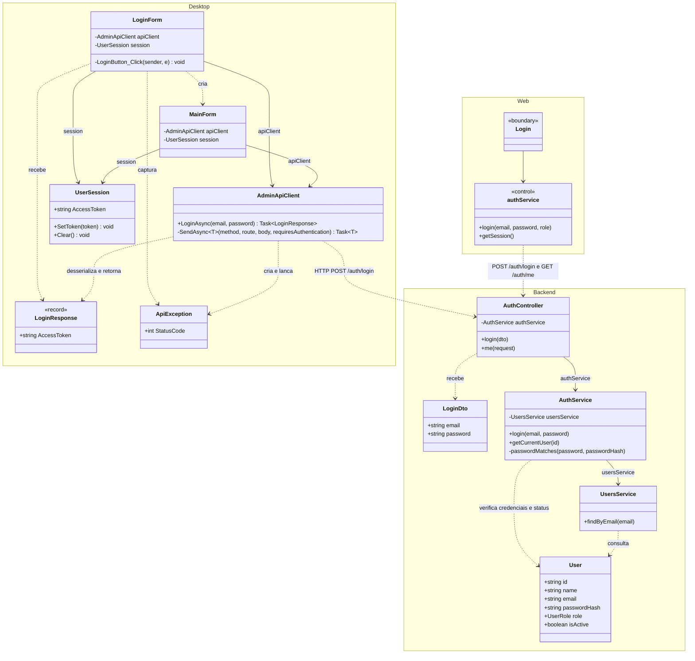
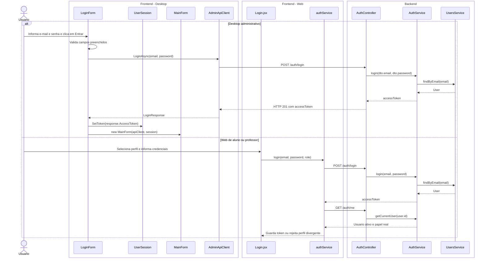

# 1. Fazer login - Administrador, aluno e professor

**Atores:** administrador no desktop; aluno (`student`) e professor (`teacher`) na web.

## Estado e escopo do desktop

**Status:** implementado no Desktop, com uma ressalva de acesso ao frontend.
Analise estatica do codigo em 28/10/2026; nao houve execucao do aplicativo.

**O que tem:** formulario de e-mail e senha, campos obrigatorios, chamada real a
`POST /auth/login`, verificacao de senha e usuario ativo, JWT em memoria,
abertura da `MainForm` e tratamento de falha de conexao/credenciais.

**O que falta:** nada para o administrador com credenciais validas entrar.
Porem, qualquer perfil ativo passa pela autenticacao e chega a abrir a tela
principal. O bloqueio de nao administradores ocorre na consulta `GET /users`,
protegida pela API, que provoca o retorno ao login.

**Como fazer com o minimo de alteracao:** se a entrada no Desktop precisar ser
exclusiva do administrador, usar a consulta protegida `GetUsersAsync()` antes
de abrir a `MainForm`. Em 401/403, limpar a sessao, permanecer no login e
informar acesso nao autorizado. Nao mudar o login compartilhado da API para
aceitar apenas administradores: ele tambem atende alunos e professores.
Nao e necessario criar endpoint de login separado, decodificador JWT ou tabela.

**Verificacao de aceite:** admin ativo entra; senha incorreta e conta inativa
nao entram; aluno/professor nao abre a tela principal apos o ajuste proposto.

## Login de aluno e professor na web

Implementado em 04/11/2026, preservando o layout existente e sem alterar o
fluxo do desktop. As contas devem ser criadas pelo administrador; o login
nao cadastra novos usuarios.

1. Usuario seleciona Estudante ou Professor e informa e-mail e senha.
2. `Login` chama `POST /auth/login`, enviando somente e-mail e senha.
3. Com o JWT retornado, consulta `GET /auth/me`, protegido por `JwtAuthGuard`.
   A API verifica assinatura, expiracao, conta ativa e perfil atual.
4. A web compara o perfil real ao selecionado e rejeita divergencias e contas
   administrativas, sem guardar o token nesses casos.
5. Em sucesso, guarda somente o token em `sessionStorage` e direciona o aluno
   para `/aluno` ou o professor para `/professor`.
6. Os loaders das rotas consultam a sessao na API antes de liberar o acesso.
   Sem sessao, retornam a `/login`; perfil inadequado volta a sua propria area.
7. Sair remove o token. Respostas 401/403 na verificacao de sessao tambem o
   removem; falhas temporarias de rede/API nao apagam uma sessao existente.

O navegador nao autoriza chamadas de API: os guards do backend continuam
obrigatorios. O token sobrevive a recarga da aba; a senha nao e persistida.
Sem refresh token ou recuperacao de senha neste escopo.

### Verificacao da web

`npm test` em `apps/web` cobre login dos dois perfis, divergencia de perfil,
bloqueio de administradores, credenciais invalidas, sessao rejeitada pela API,
logout, falha de rede, indisponibilidade temporaria e protecao de rotas.
Os testes do backend cobrem a consulta do usuario ativo sem hash de senha.

Fluxos de navegador verificados com respostas simuladas da API: acesso direto
sem sessao, login, recarga, logout, retorno pelo historico, bloqueio entre
perfis, sessao expirada e falha de conexao, incluindo viewport movel.

Validacao integrada realizada em 04/11/2026 com web, API e SQL Server no
Docker Compose, sem simular respostas. Confirmados login dos dois perfis,
credenciais invalidas, identidade retornada pela API, recarga da pagina,
logout, bloqueio entre perfis, acesso anonimo e funcionamento em viewport
movel. As chamadas passaram pelo proxy do Vite.

Na API, confirmados bloqueio de JWT invalido e de JWT assinado mas expirado,
permissoes de aluno/professor e pontuacao inicial zero. A desativacao de uma
conta bloqueou novo login e invalidou o acesso de uma sessao ja aberta,
retornando a tela de login e removendo o token do navegador.

Foram criadas duas contas exclusivas para o teste, uma de cada perfil, e
ambas foram desativadas ao final. Containers existentes do backend e do
banco foram preservados; nenhum volume ou registro preexistente foi removido.

## UML do estado atual

O diagrama inclui os clientes desktop e web e o caminho de autenticacao atual.

## Diagrama de classes

`LoginResponse` e um record do C#. `User` e a entidade do backend.
Linha continua indica associacao; linha tracejada indica dependencia.

## Diagrama de sequencia

`<<boundary>>` identifica telas e componentes de interface; `<<control>>`
identifica modulos web que coordenam chamadas HTTP e sessao. Frontend a esquerda e backend a direita. Os DTOs e a entidade aparecem como
dados das mensagens. `ApiException` nao participa do caminho feliz.
Operacoes herdadas, como `Hide` e `ShowDialog`, sao indicadas sem adicionar
classes do framework.

**Regra atual:** o endpoint aceita qualquer usuario ativo com senha correta.
A permissao de administrador e exigida na consulta de usuarios da `MainForm`.

**Fontes:** `apps/desktop/src/EduQuest.Admin.Desktop/` e `apps/server/src/`,
especialmente `LoginForm.cs`, `Networking/AdminApiClient.cs`,
`auth/auth.controller.ts`, `auth/auth.service.ts` e `users/users.service.ts`.
