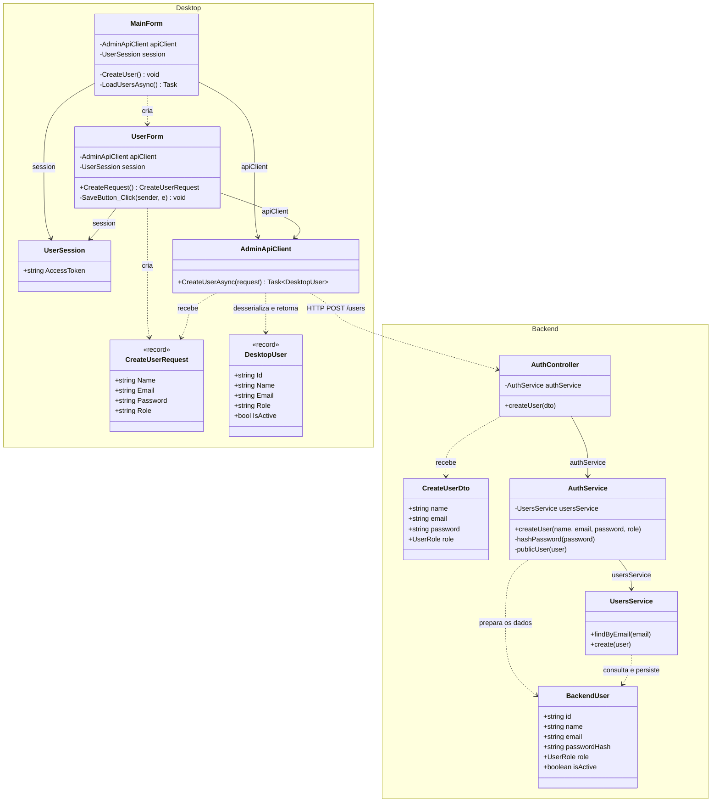
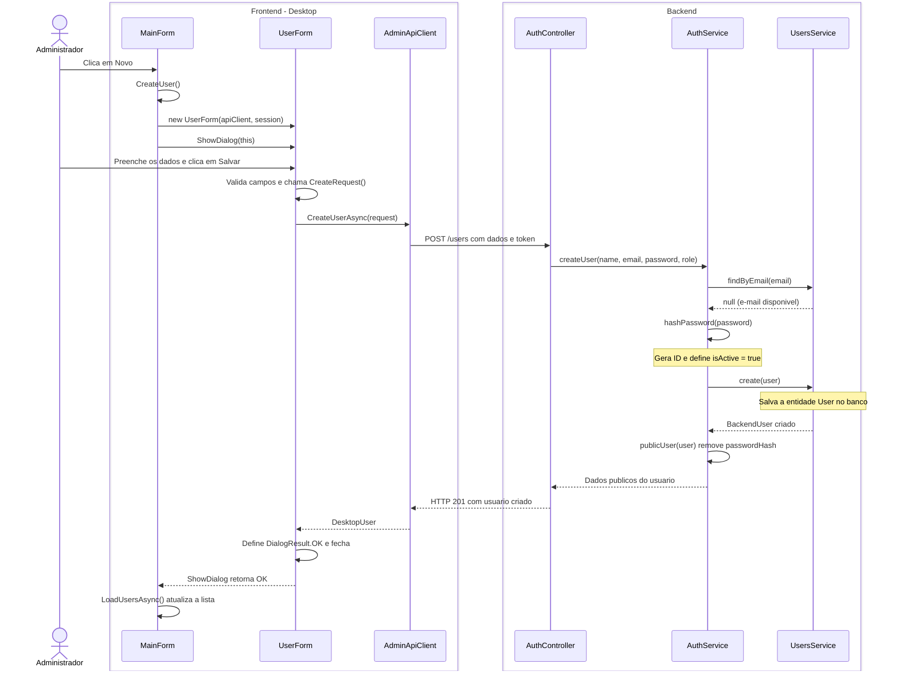

# 2. Incluir usuario - Administrador

**Atores:** administrador.

**Precondicao:** administrador autenticado, com a tela principal aberta.

## Estado e escopo

**Status:** implementado no Desktop e na API. Analise estatica do codigo em
28/10/2026; nao houve execucao do aplicativo.

**O que tem:** botao Novo; formulario com nome, e-mail, senha e selecao de papel
`admin`, `teacher` ou `student` (padrao); envio real a `POST /users`; acesso
restrito ao administrador; validacao de e-mail, senha de no minimo 8 caracteres
e papel permitido; rejeicao de e-mail duplicado; hash de senha; persistencia
com `isActive = true`; atualizacao da lista apos salvar.

**O que falta:** nenhuma funcionalidade para o caso de uso informado.

**Como fazer:** manter `MainForm`, `UserForm`, `AdminApiClient`, `AuthController`,
`AuthService` e `UsersService` como estao. Nao criar outro cadastro, endpoint ou
servico. Os diagramas abaixo representam a implementacao existente.

**Verificacao de aceite:** cadastrar um usuario de cada papel e conferir a lista;
tentar e-mail repetido, e-mail invalido e senha curta; confirmar que aluno e
professor nao conseguem cadastrar pela API.

## UML do estado atual

Somente classes do projeto e o caminho feliz. Login, autorizacao, estilizacao
e detalhes da atualizacao da lista ficam fora do fluxo.

## Diagrama de classes

`DesktopUser` e `BackendUser` identificam as classes `User` de cada aplicacao.
Sao tipos distintos, sem heranca entre eles.

## Diagrama de sequencia

Frontend a esquerda e backend a direita. Objetos de requisicao e usuarios
aparecem nos dados das mensagens. O cliente envia o token da sessao existente.

**Fontes:** `MainForm.cs`, `UserForm.cs`, `Models/CreateUserRequest.cs`,
`Models/User.cs` e `Networking/AdminApiClient.cs` no Desktop;
`auth/auth.controller.ts`, `auth/dto/create-user.dto.ts`, `auth/auth.service.ts`,
`users/users.service.ts` e `users/user.entity.ts` no backend.
