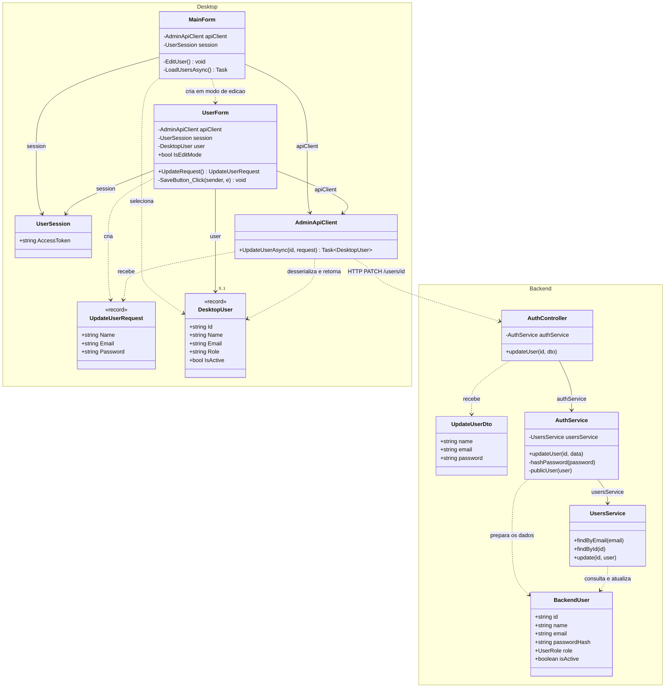
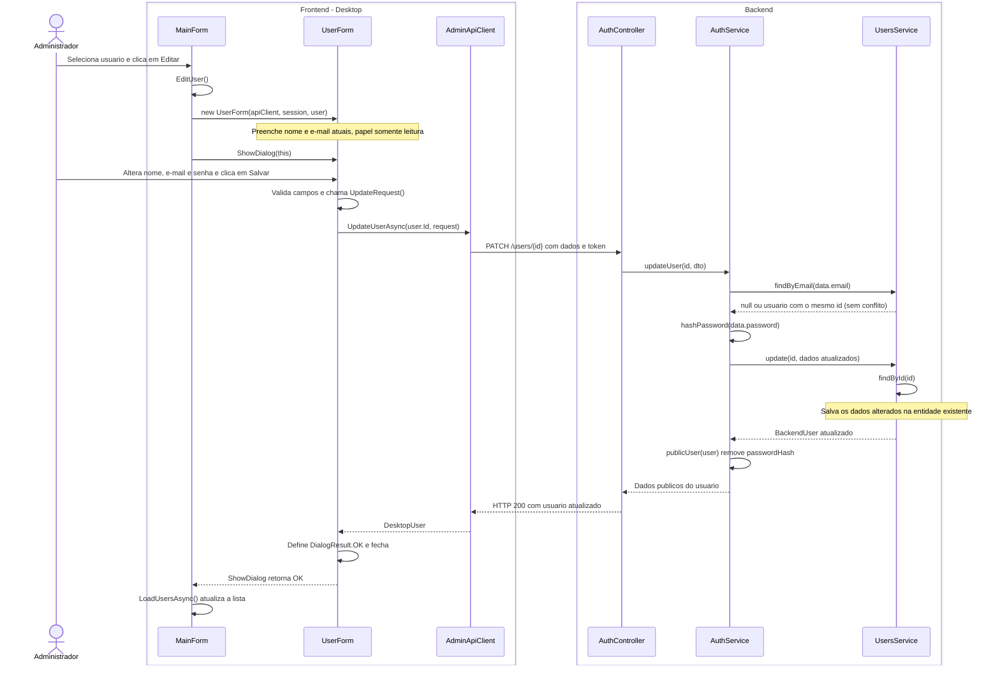

# 3. Editar usuario

**Ator:** administrador.

**Precondicao:** administrador autenticado, com a lista de usuarios carregada.

## Estado e escopo

**Status:** implementado para nome, e-mail e senha. Analise estatica do codigo
em 28/10/2026; nao houve execucao do aplicativo.

**O que tem:** selecao do usuario na tabela, botao Editar, formulario preenchido,
senha opcional, `PATCH /users/:id` restrito ao administrador, validacao de dados,
verificacao de e-mail ja usado por outro usuario, hash da nova senha e
atualizacao da lista. Senha vazia mantem a senha anterior.

**O que falta:** nada para editar os campos descritos. Alterar papel nao existe:
o formulario o mostra somente para leitura e `UpdateUserRequest` e
`UpdateUserDto` nao possuem esse campo.

**Como fazer:** manter a implementacao atual. Selecionar papel na inclusao nao
implica obrigatoriamente permitir troca na edicao. A troca de papel so deve
entrar no escopo se for exigida pelo trabalho; nesse caso, ajustar o mesmo
`UserForm`, os dois contratos de atualizacao e `AuthService.updateUser`, com
validacao dos tres papeis, sem criar outra tela ou endpoint. Essa extensao e
condicional, nao uma pendencia obrigatoria deste caso.

**Verificacao de aceite:** editar nome/e-mail; salvar sem nova senha e conferir
que a anterior funciona; definir nova senha de pelo menos 8 caracteres e
conferir o login; rejeitar e-mail de outro usuario e edicao por nao administrador.

## UML do estado atual

Somente classes do projeto e o caminho feliz. O papel nao pode ser alterado.
A senha e opcional: se ficar vazia, a atual e mantida. A sequencia considera
uma nova senha preenchida, sem detalhar login, autorizacao ou fluxos de erro.

## Diagrama de classes

`DesktopUser` e `BackendUser` representam as classes `User` de cada aplicacao.

## Diagrama de sequencia

Frontend a esquerda e backend a direita. Objetos de requisicao e usuarios
aparecem nos dados das mensagens, sem linhas de vida proprias.

**Fontes:** `MainForm.cs`, `UserForm.cs`, `Models/UpdateUserRequest.cs`,
`Models/User.cs` e `Networking/AdminApiClient.cs` no Desktop;
`auth/auth.controller.ts`, `auth/dto/update-user.dto.ts`, `auth/auth.service.ts`,
`users/users.service.ts` e `users/user.entity.ts` no backend.
