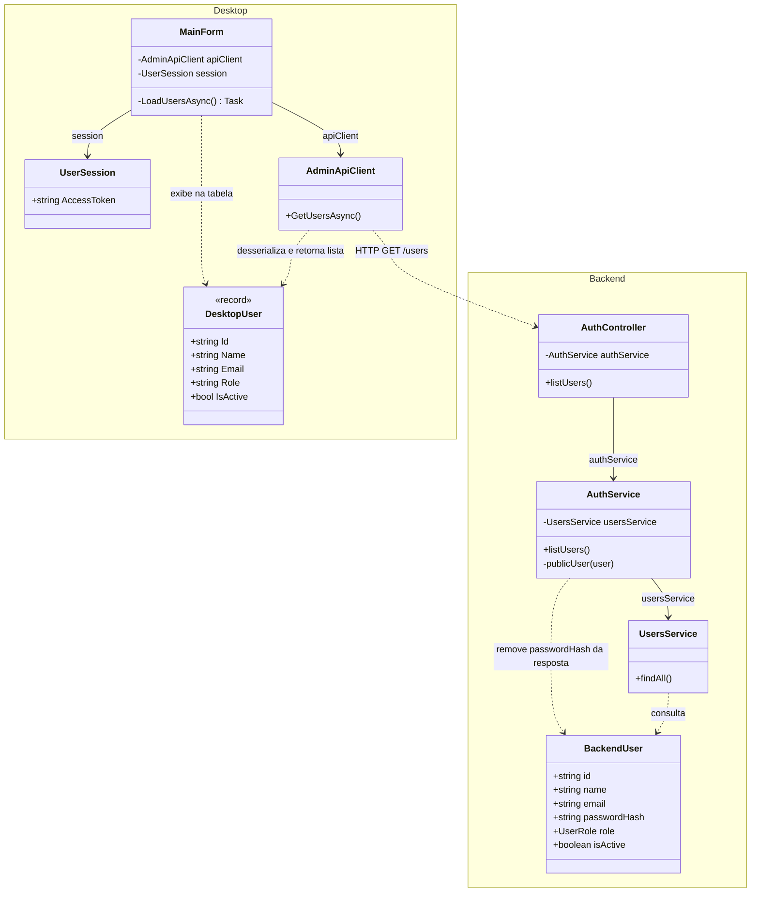
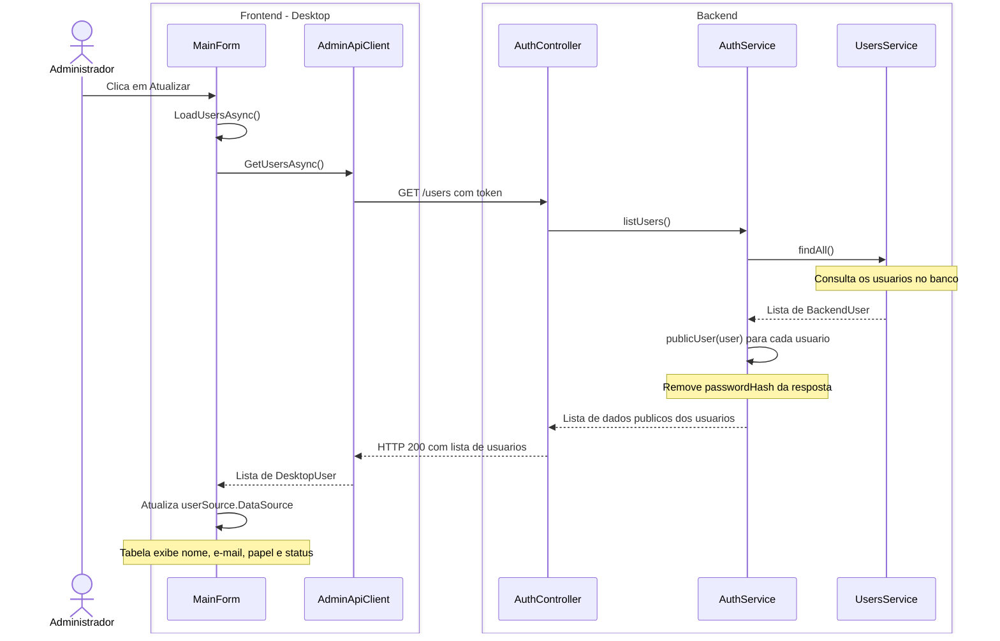

# 4. Listar usuarios - Administrador

**Atores:** administrador.

**Precondicao:** administrador autenticado.

## Estado e escopo

**Status:** implementado no Desktop e na API. Este arquivo foi mantido porque
ja faz parte da documentacao e apoia inclusao, edicao e desativacao.
Analise estatica do codigo em 28/10/2026; nao houve execucao do aplicativo.

**O que tem:** carregamento ao abrir a tela principal ou clicar em Atualizar;
`GET /users` restrito ao administrador; consulta real ao banco, sem retornar
hash de senha; tabela com nome, e-mail, papel e status de ativos e inativos.

**O que falta:** nenhuma funcionalidade para a listagem simples existente.

**Como fazer:** manter a consulta e a tabela atuais. Busca, filtros e paginacao
nao sao necessarios para os casos discutidos; nao adiciona-los por antecipacao.
Os diagramas abaixo representam a implementacao existente.

**Verificacao de aceite:** conferir usuarios ativos e inativos; atualizar apos
uma alteracao; confirmar bloqueio da API para perfis diferentes de admin.

## UML do estado atual

Somente classes do projeto e o caminho feliz. A lista e carregada ao abrir a
tela principal ou clicar em Atualizar. A sequencia considera o clique em
Atualizar, sem detalhar login, autorizacao ou fluxos de erro.

## Diagrama de classes

`DesktopUser` e `BackendUser` identificam as classes `User` de cada aplicacao.
Sao tipos distintos, sem heranca entre eles. Componentes visuais e classes de
bibliotecas nao sao representados.

## Diagrama de sequencia

Frontend a esquerda e backend a direita. Os usuarios aparecem nos dados das
mensagens, sem linhas de vida proprias. O cliente envia o token da sessao
existente.

**Regra atual:** a consulta retorna usuarios ativos e inativos, sem filtro ou
paginacao. A tabela apresenta o status como Ativo ou Inativo.

**Fontes:** `MainForm.cs`, `Models/User.cs`, `Session/UserSession.cs` e
`Networking/AdminApiClient.cs` no Desktop;
`auth/auth.controller.ts`, `auth/auth.service.ts`, `users/users.service.ts`
e `users/user.entity.ts` no backend.
