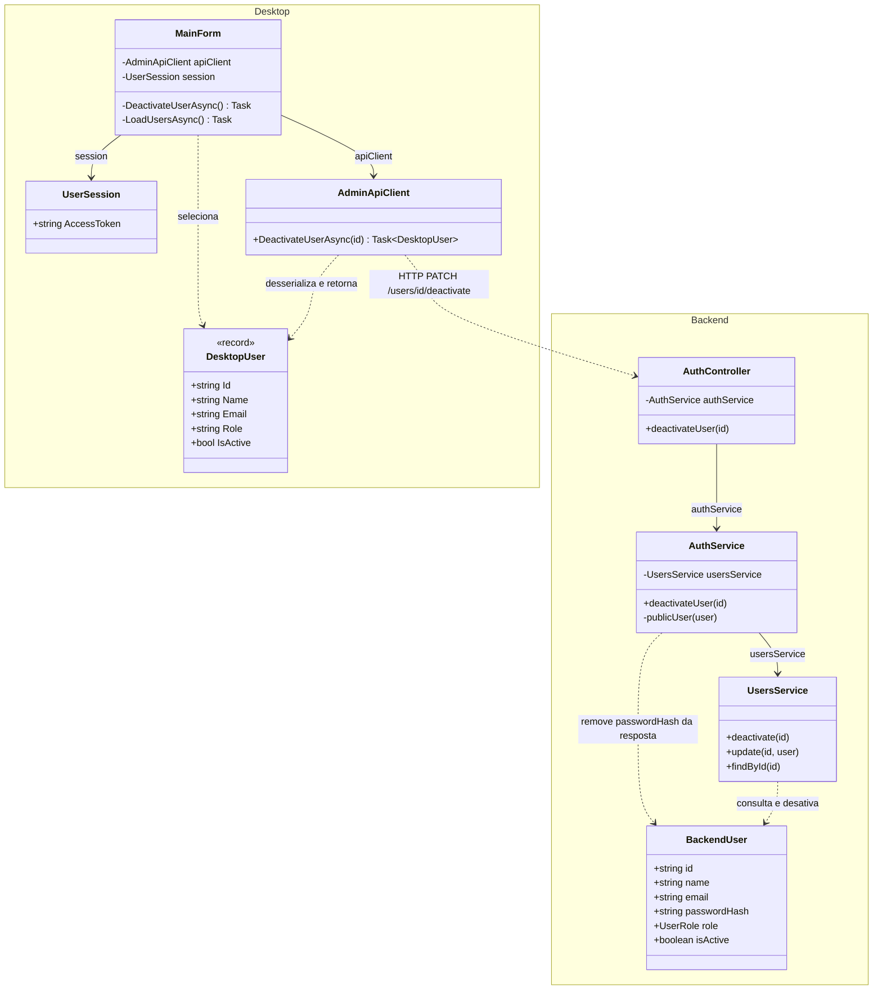
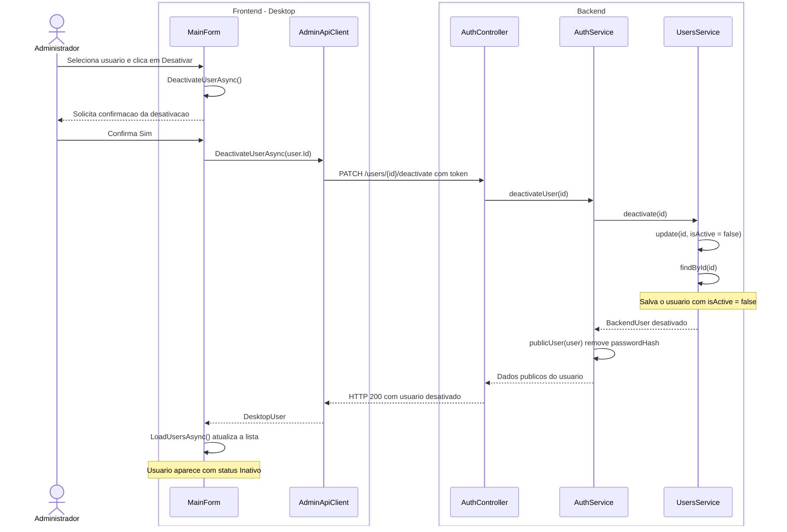

# 5. Desativar usuario

**Ator:** administrador.

**Precondicao:** administrador autenticado, com um usuario ativo selecionado
na lista.

## Estado e escopo

**Status:** implementado no Desktop e na API. Analise estatica do codigo em
28/10/2026; nao houve execucao do aplicativo.

**O que tem:** selecao do usuario, botao Desativar, confirmacao, chamada real a
`PATCH /users/:id/deactivate` restrita ao administrador, persistencia de
`isActive = false` sem excluir o registro e atualizacao da lista. A API rejeita
novos logins do desativado. `JwtAuthGuard` tambem verifica o status no banco em
cada requisicao protegida, bloqueando um token emitido antes da desativacao.

**O que falta:** nenhuma funcionalidade para o caso informado. Nao ha bloqueio
contra desativar a propria conta ou o ultimo administrador; essas regras nao
foram exigidas e nao sao tratadas aqui como trabalho obrigatorio.

**Como fazer:** manter o fluxo existente, sem exclusao fisica, tabela de
inativos ou mecanismo separado para revogar tokens. Reativacao e protecao do
ultimo administrador so entram se forem solicitadas como regras do trabalho.
Os diagramas abaixo representam a implementacao existente.

**Verificacao de aceite:** cancelar nao altera o usuario; confirmar exibe Inativo
e preserva o registro; login e acesso protegido com token anterior sao negados
ao usuario desativado; nao administrador nao consegue executar a operacao.

## UML do estado atual

Somente classes do projeto e o caminho feliz. O administrador confirma a acao,
o usuario e desativado e a lista e atualizada. Login, autorizacao e fluxos de
erro ficam fora do diagrama.

## Diagrama de classes

`DesktopUser` e `BackendUser` identificam as classes `User` de cada aplicacao.
Sao tipos distintos, sem heranca entre eles. A confirmacao e exibida pela
`MainForm`, sem representar componentes do framework.

## Diagrama de sequencia

Frontend a esquerda e backend a direita. Os usuarios aparecem como dados das
mensagens. O cliente envia o token da sessao existente. A atualizacao da lista
e indicada sem repetir o fluxo de Listar usuarios.

**Regra atual:** desativar altera `isActive` para `false`, sem excluir o registro.
O usuario continua na lista, mas nao pode fazer login.

**Fontes:** `MainForm.cs`, `Models/User.cs`, `Session/UserSession.cs` e
`Networking/AdminApiClient.cs` no Desktop;
`auth/auth.controller.ts`, `auth/auth.service.ts`, `users/users.service.ts`
e `users/user.entity.ts` no backend.
