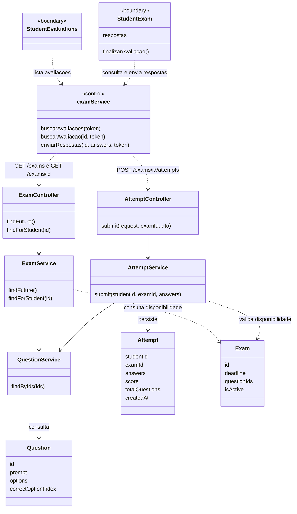
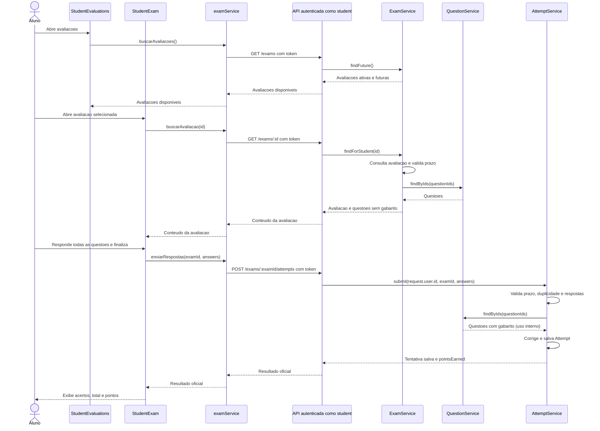

# 6. Fazer avaliacao - Aluno

**Atores:** aluno (`student`). **Frontends:** web e mobile.

**Precondicao do fluxo real:** aluno autenticado e ativo, avaliacao dentro do
prazo e ainda nao respondida por ele. A autenticacao web usa a API real.

## Estado atual

Implementado e validado na web em 04/11/2026, com API e SQL Server no Docker.

| Parte | Status | Implementacao |
| --- | --- | --- |
| Web | Implementado | Lista avaliacoes reais, carrega questoes, preserva escolhas durante a navegacao e envia respostas para correcao no servidor. |
| API | Implementado | `GET /exams/:id` entrega conteudo sem gabarito; o POST de tentativas valida, corrige, persiste e soma os pontos ao usuario na mesma transacao. |
| Mobile | Nao implementado | Fora do escopo desta entrega web. |

A consulta individual e exclusiva do aluno autenticado, valida UUID e prazo
e retorna somente `id`, `title`, `description`, `deadline` e
`questions: [{ id, prompt, options }]`. Preserva a ordem de `questionIds` e
rejeita conteudo com questoes ausentes. Nao retorna `correctOptionIndex` nem
entidades completas de questao. A consulta `/questions` permanece exclusiva
do professor. A rota estatica `/exams/mine` continua antes de `:id`.

A tela exige todas as respostas antes de finalizar e bloqueia novo envio
enquanto a requisicao esta em andamento. O payload contem somente
`answers: [{ questionId, selectedOptionIndex }]`, com indices iniciados em zero.
Nao envia nota ou pontos calculados pelo navegador. Somente apos sucesso
mostra `score`, `totalQuestions` e `pointsEarned` retornados pela API.

Falha de conexao preserva as respostas e permite tentar novamente. Prazo
encerrado, avaliacao indisponivel e tentativa ja enviada nao geram sucesso.
Respostas 401/403 encerram a sessao. A API rejeita indices negativos, fracionarios
ou fora das alternativas, respostas ausentes, estranhas ou repetidas e trata
UUIDs sem diferenciar maiusculas/minusculas do SQL Server.

Os pontos acumulados sao exibidos na entrada do aluno, usando os dados de
`GET /auth/me`. A listagem ainda inclui avaliacoes futuras ja respondidas;
nesse caso, repetir o envio retorna HTTP 409 sem gerar novos pontos. O resultado
imediato fica na tela, nao em armazenamento local. Os resultados salvos podem
ser consultados em `/desempenho`, implementado no caso 7. Nao ha rascunho
persistente, novas tentativas, cronometro ou desativacao de avaliacoes neste caso.

### Validacao realizada

- 19 testes web e 44 testes backend passaram; builds dos dois apps aprovados.
- Fluxo real no Docker: listagem, busca, abertura por ID, resposta, correcao,
  persistencia da tentativa e dos pontos apos navegar e recarregar.
- A resposta de conteudo nao possui gabarito; professor e acesso anonimo sao
  bloqueados nessa rota, e aluno nao acessa o banco de questoes do professor.
- Prazo foi testado com uma avaliacao real que expirou: deixou a listagem,
  retornou 404 na consulta e 400 no envio, sem somar pontos.
- Respostas invalidas e envio de nota pelo cliente foram rejeitados na API.
  Repetir uma tentativa valida retornou 409 e manteve a pontuacao anterior.
- Falha de rede e atraso de envio provocados no navegador confirmaram escolhas
  preservadas e bloqueio de duplo envio. Tela de questoes e resultado cabem em
  viewport movel. Navegacao entre varias questoes e troca de avaliacao foram
  verificadas com conteudo simulado, sem envia-lo para o banco.
- As contas temporarias foram desativadas; o aluno demo permaneceu com zero
  pontos e sem utilizar a tentativa da avaliacao demo.

O lint dos arquivos alterados passou. O lint geral da web mantem o erro
preexistente de Fast Refresh em `components/ui/button.jsx`.

## Planejamento original (historico)

A analise abaixo foi registrada em 28/10/2026 e preserva o desenho original.
As mencoes a demonstracao e propostas descrevem aquele momento; o estado
implementado e o resumido acima.

| Parte | Status | O que tem |
| --- | --- | --- |
| Web | Parcial: demonstracao local | Lista fixa, tela de questoes, selecao de alternativas, navegacao e resultado local. |
| API | Parcial para o fluxo completo | Lista avaliacoes futuras; recebe, valida, corrige e salva uma tentativa por aluno/avaliacao. Falta consulta das questoes para o aluno. |
| Mobile | Nao implementado | Sem telas ou servicos; diretorio contem apenas `agents.md`. |

`StudentEvaluations` usa avaliacoes fixas. `StudentExam` sempre mostra tres
questoes de Python, independentemente do ID da URL, com gabarito no frontend.
As respostas ficam em `useState`; finalizar apenas altera `finalizada`.
Nao ha envio, persistencia ou atualizacao real do historico pela web.
`examService.js` ja possui `buscarAvaliacoes(token)`, mas a listagem de
`StudentEvaluations` nao o utiliza. O login web nao obtem token da API.

## O que precisa fazer

1. Conectar o login web a `POST /auth/login`, manter o token para chamadas e
   impedir acesso as telas do aluno sem sessao/perfil adequado. O perfil
   selecionado na interface nao substitui a autorizacao da API.
2. Usar `buscarAvaliacoes(token)` em `StudentEvaluations`, removendo a lista fixa.
3. Disponibilizar o conteudo de uma avaliacao ao aluno sem retornar o gabarito.
4. Carregar esse conteudo em `StudentExam` e enviar as alternativas escolhidas
   ao endpoint de tentativa existente, em vez de corrigir no navegador.
5. Mostrar o resultado retornado pela API e tratar carregamento, erro, prazo
   vencido, tentativa ja enviada e sessao nao autorizada.
6. No mobile, quando for implementado, criar somente listagem, realizacao e
   resultado consumindo os mesmos contratos. Nao duplicar a correcao no app.

## Como fazer com o minimo de alteracao

### API

Manter `GET /exams` e `POST /exams/:examId/attempts`. O POST ja verifica prazo,
duplicidade, quantidade de respostas, IDs das questoes e limites das alternativas;
calcula acertos e salva em `Attempt`. Nao criar outra entidade de prova respondida.

**Adicionar (proposta, ainda nao implementada):** `GET /exams/:id` em
`ExamController`, com `JwtAuthGuard`, `RolesGuard` e `@Roles('student')`, usando
um metodo `findForStudent(id)` em `ExamService`. Consultar a avaliacao pelo ID,
validar existencia e prazo e usar `QuestionService.findByIds` ja existente.
Preservar a ordem de `questionIds` e rejeitar conteudo com questoes ausentes.

Ao implementar a desativacao proposta no [caso 10](10-desativar-avaliacao-professor.md),
exigir tambem `isActive = true` na listagem, nesta consulta individual e no
envio de tentativas. O campo ainda nao existe; essa e uma dependencia proposta,
nao uma validacao ja implementada. Declarar a rota estatica `/exams/mine` do
professor antes da rota `:id` para evitar conflito de roteamento.

Retornar somente `id`, `title`, `description`, `deadline` e
`questions: [{ id, prompt, options }]`. Projetar explicitamente os campos:
**nunca devolver `correctOptionIndex` ao aluno**. Nao liberar a consulta de
questoes do professor nem retornar entidades `Question` completas.

### Web e mobile

Reutilizar `examService.js` para acrescentar a consulta individual e o envio.
Na listagem, adaptar `title`, `description` e `deadline` da API aos campos
exibidos hoje como `titulo`, `descricao` e `prazo`, ou ajustar as leituras na
tela, formatando a data. Remover a materia ficticia dos cartoes e da busca:
`Exam` nao possui esse campo e nao e necessario adiciona-lo ao banco.

As chamadas existentes usam URL relativa. Em desenvolvimento,
`apps/web/vite.config.js` encaminha apenas `/exams` ao backend; acrescentar
`/auth` e `/attempts` ao mesmo proxy para login e historico chegarem a API.
No mobile futuro, configurar o endereco real da API, pois ele nao usa o proxy
do Vite. Nao e preciso instalar cliente HTTP: `fetch` ja atende a web.

Reutilizar os componentes existentes e `respostas` para montar:
`{ answers: [{ questionId, selectedOptionIndex }] }`. Os indices iniciam em zero.
Exigir todas as questoes respondidas, pois esse e o contrato atual do backend.
Desabilitar o envio enquanto estiver em andamento e so concluir a tela apos
sucesso. Em erro de conexao, preservar as escolhas e permitir tentar novamente;
se a primeira chamada ja tiver sido salva, a API bloqueia a duplicidade.

Usar `score` como quantidade de acertos, `totalQuestions` como total e
`pointsEarned` como pontos (10 por acerto). Nao confundir pontos com nota de 0 a
10. Nao criar cronometro, rascunho persistente, novas tentativas, tabelas ou
dependencias: nada disso foi pedido. `GET /exams` hoje nao remove avaliacoes ja
respondidas; no minimo, tratar o conflito informado pelo POST sem mostrar sucesso.

O mobile reutilizara a mesma API, mas nao ha tecnologia ou classes de tela
definidas no repositorio; por isso os diagramas nao inventam classes mobile.

## UML do estado atual

`StudentExam` e `StudentEvaluations` sao componentes React, e `examService` e
um modulo JS, representados como componentes logicos no diagrama.
`<<boundary>>` representa uma interface React; `<<control>>`, a logica web que
coordena as chamadas a API.

## Diagrama de sequencia

## Verificacao de aceite

- Duas avaliacoes diferentes exibem seus respectivos enunciados e alternativas.
- Resposta de consulta e bundle frontend nao contem o gabarito real.
- Aluno autenticado envia todas as respostas e recebe acertos/pontos da API.
- A tentativa aparece no banco e no historico descrito em [Consultar avaliacoes
  realizadas](07-consultar-avaliacoes-realizadas-aluno.md) depois de sua implementacao.
- Envio incompleto, repetido, fora do prazo e acesso sem permissao nao geram
  tentativa valida; erro de conexao nao apaga respostas da tela.

## Fontes

- `apps/web/src/pages/student/StudentEvaluations.jsx`
- `apps/web/src/pages/student/StudentExam.jsx`
- `apps/web/src/pages/auth/Login.jsx`, `apps/web/src/main.jsx`
- `apps/web/src/services/examService.js`
- `apps/server/src/exam/exam.controller.ts`, `exam.service.ts`, `exam.entity.ts`
- `apps/server/src/question/question.service.ts`, `question.entity.ts`
- `apps/server/src/attempt/attempt.controller.ts`, `attempt.service.ts`, `attempt.entity.ts`
- `apps/server/src/auth/jwt-auth.guard.ts`, `roles.guard.ts`
