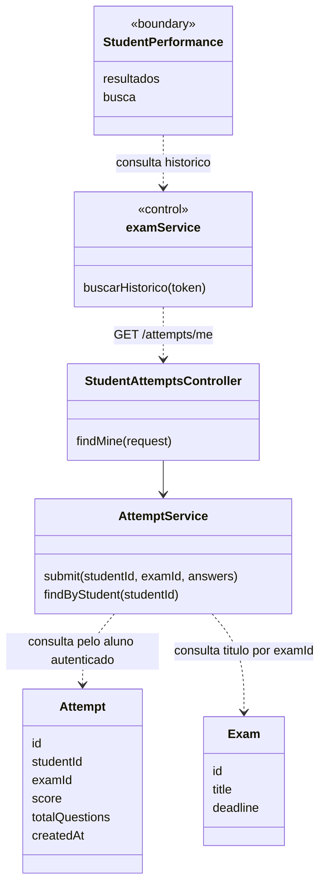
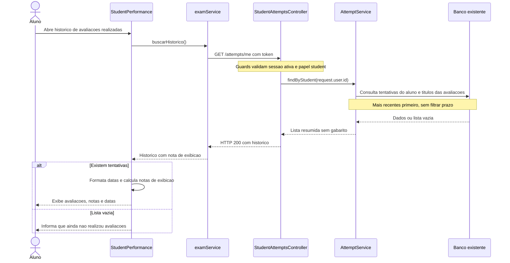

# 7. Consultar avaliacoes realizadas - Aluno

**Atores:** aluno (`student`). **Frontends:** web e mobile.

**Precondicao do fluxo real:** aluno autenticado e ativo. Nao e preciso ter
tentativas: nesse caso a consulta deve apresentar historico vazio.

## Estado atual

Implementado e validado na web em 04/11/2026, com API e SQL Server no Docker.

| Parte | Status | Implementacao |
| --- | --- | --- |
| Web | Implementado | `/desempenho` consulta resultados reais, busca por titulo e exibe datas, acertos, nota, media e maior nota. |
| API | Implementado | `GET /attempts/me`, restrito a aluno ativo, consulta somente as tentativas do usuario identificado pelo JWT. |
| Mobile | Nao implementado | Fora do escopo desta entrega web; pode consumir o mesmo endpoint futuramente. |

`StudentAttemptsController` usa `JwtAuthGuard` e `RolesGuard` e chama
`AttemptService.findByStudent(request.user.id)`. Nao aceita outro aluno por
parametro. A consulta junta `Attempt` a `Exam` para obter o titulo, ordena por
`createdAt` e ID decrescentes e projeta somente `id`, `examId`, `title`, `score`,
`totalQuestions` e `createdAt`. Nao retorna respostas, gabarito ou dados de
outros usuarios. Historico vazio retorna HTTP 200 com `[]`.

Nao ha filtro por prazo ou disponibilidade da avaliacao: resultados de provas
vencidas permanecem no historico. O campo ativo/inativo sera adicionado no caso
10 e tambem nao deve restringir essa consulta. Nenhuma nova tabela ou nota
persistida foi criada; a leitura nao altera tentativas nem pontos do usuario.

`buscarHistorico` reutiliza o cliente HTTP existente e acrescenta somente a
nota de exibicao `score / totalQuestions * 10`, ou zero quando o total e zero.
A tela formata a nota visualmente, calcula media e maior nota sobre todo o
historico e mantem a busca local por titulo. Materia e resultados ficticios
foram removidos. O resultado imediato da prova oferece um link para a tela.

Carregamento, erro, historico vazio e busca sem correspondencia sao estados
distintos. Falha de rede/API permite nova tentativa sem apresentar notas
ficticias; 401/403 limpa a sessao e retorna ao login. A lista completa e adequada
ao escopo academico atual; paginacao fica para quando houver necessidade real.

### Validacao realizada

- 22 testes web e 47 testes backend passaram; builds dos dois apps aprovados.
- API real confirmou isolamento entre alunos, inclusive com `studentId` de
  outro aluno enviado na query; professor e administrador receberam 403 e
  acesso anonimo recebeu 401. A resposta possui somente os seis campos previstos.
- Uma tentativa real continuou consultavel depois de o prazo vencer. Uma nova
  tentativa apareceu pelo link do resultado, em ordem decrescente, e persistiu
  apos recarregar a pagina.
- Duas tentativas reais, com notas 0 e 10, exibiram media 5 e maior nota 10;
  a busca por titulo nao alterou o resumo global. Um segundo aluno recebeu
  historico vazio sem dados do primeiro.
- A tela foi validada em viewport movel. Falha temporaria e 401 foram
  provocados no navegador para conferir retry e encerramento da sessao.
  Conversao de 3/4 para 7,5 e total zero tambem foram conferidos com payloads
  simulados, sem gravar esses dados no banco.
- As tres contas temporarias foram desativadas ao final; contas demo e dados
  preexistentes foram preservados.

O lint dos arquivos alterados passou. O lint geral da web mantem o erro
preexistente de Fast Refresh em `components/ui/button.jsx`.

## Planejamento original (historico)

O registro abaixo preserva a analise de 28/10/2026. As propostas e pendencias
descrevem aquele momento; o estado atual esta resumido acima.

| Parte | Status | O que tem |
| --- | --- | --- |
| Web | Parcial: demonstracao local | `StudentPerformance` mostra historico, busca, notas, datas, media e maior nota a partir de um array fixo. |
| API | Consulta nao implementada | `Attempt` armazena aluno, avaliacao, respostas, acertos, total e data, mas nao existe endpoint de historico do aluno. |
| Mobile | Nao implementado | Sem telas ou servicos. |

`StudentEvaluations` lista avaliacoes para realizar, nao um historico.
`StudentExam` nao envia tentativas reais. Finalizar essa tela nao altera o array
de resultados de `StudentPerformance`. `GET /leaderboard` agrega pontos de
varios alunos e nao substitui consulta individual. `GET /exams` lista apenas
avaliacoes futuras, portanto nao deve ser usado para reconstruir o historico.

## O que precisa fazer

1. Criar consulta autenticada que retorne somente tentativas do proprio aluno,
   incluindo titulo da avaliacao, data, acertos e total de questoes.
2. Conectar `StudentPerformance` a essa consulta, removendo o array fixo e
   mantendo o layout e a busca local que ja existem.
3. Tratar carregamento, falha de consulta, sessao nao autorizada e historico vazio.
4. Usar o login/token e o envio real descritos em [Fazer avaliacao](06-fazer-avaliacao-aluno.md).
   A consulta pode ser implementada antes do envio web e validada com tentativas
   cadastradas pelo POST da API.
5. No mobile futuro, criar uma tela de historico usando o mesmo endpoint.

## Como fazer com o minimo de alteracao

### API

**Adicionar (proposta, ainda nao implementada):** `GET /attempts/me`.
Declarar um pequeno `StudentAttemptsController` no arquivo
`attempt.controller.ts`, protegido por `JwtAuthGuard`, `RolesGuard` e
`@Roles('student')`, e registra-lo no `AttemptModule` existente. O prefixo atual
de `AttemptController` e `/exams/:examId/attempts`; por isso nao acrescentar um
`@Get('me')` nele, pois a rota continuaria exigindo `examId`.

Reutilizar `AttemptService`: adicionar `findByStudent(studentId)`, consultando
o repositorio de tentativas com filtro pelo `request.user.id` e ordenacao por
`createdAt` decrescente. Juntar `Exam` por `examId` para trazer o titulo; o
servico ja possui acesso ao repositorio de avaliacoes. Nao filtrar pelo prazo:
avaliacoes vencidas tambem fazem parte do historico. Nao receber `studentId`
da URL ou do corpo; a identidade vem do JWT validado pela API.

A mesma regra vale para avaliacoes desativadas apos o [caso 10](10-desativar-avaliacao-professor.md):
nao filtrar `Exam.isActive` ao consultar historico. O campo proposto representa
disponibilidade para realizar a avaliacao, nao validade dos resultados salvos.

Retornar uma lista simples com `id`, `examId`, `title`, `score`,
`totalQuestions` e `createdAt`, sem respostas completas ou gabarito. Lista
vazia deve retornar HTTP 200 com `[]`. Reutilizar `Attempt` e `Exam`, sem nova
tabela, migracao, entidade de historico ou alteracao no POST existente.

### Web e mobile

Acrescentar `buscarHistorico(token)` ao `examService.js` existente e chama-lo ao
abrir `StudentPerformance`. Substituir `resultados` fixos por dados da resposta.
Como a chamada sera relativa a `/attempts/me`, incluir `/attempts` no proxy
existente de `apps/web/vite.config.js`, que hoje encaminha somente `/exams`.
O encaminhamento de `/auth` para o login e tratado no caso Fazer avaliacao.
Usar `title` como nome da avaliacao e `createdAt` como data, formatada para
exibicao. Manter a busca local por titulo; nao criar paginacao ou filtros de API.

O backend guarda **acertos**, nao nota de 0 a 10. Para preservar a tela de notas,
calcular somente para exibicao `nota = score / totalQuestions * 10`, com
protecao para total zero e arredondamento visual. Recalcular media e maior nota
com os resultados reais; isso nao altera o valor persistido nem os pontos do
ranking (10 pontos por acerto).

`Exam` nao possui campo materia. Remover a materia ficticia da exibicao/busca
em vez de criar coluna ou inventar classificacao pelo titulo. A existencia de
uma tentativa ja significa avaliacao concluida; nao criar campo de status.
O mobile futuro consumira a mesma lista, sem backend separado.

Ficam fora do escopo: revisar questao por questao, consultar gabarito, baixar
boletim, editar respostas, refazer avaliacao e criar uma pagina de detalhe.
Nada disso e necessario para consultar a lista de avaliacoes realizadas.

## UML do estado atual

`StudentPerformance` e um componente React, e `examService` e um modulo JS;
a representacao abaixo nao exige transforma-los em classes.
`<<boundary>>` representa uma interface React; `<<control>>`, a logica web que
coordena as chamadas a API.

## Diagrama de sequencia

## Verificacao de aceite

- Aluno sem tentativas recebe lista vazia, sem erro e sem dados de demonstracao.
- Alunos diferentes veem apenas suas proprias tentativas, mesmo acessando a API
  diretamente; usuario sem sessao e perfil nao aluno sao bloqueados.
- Tentativa enviada pelo POST aparece ao reabrir o historico, inclusive depois
  do prazo da avaliacao, com titulo, data e resultado corretos.
- Exemplo de conversao visual: 3 acertos em 4 questoes exibem nota 7,5; os
  pontos continuam sendo 30. Total zero nao provoca divisao por zero na tela.
- Busca, media e maior nota usam os dados reais; erro de rede nao e apresentado
  como se fosse um historico vazio.

## Fontes

- `apps/web/src/pages/student/StudentPerformance.jsx`
- `apps/web/src/pages/student/StudentEvaluations.jsx`, `StudentExam.jsx`
- `apps/web/src/services/examService.js`, `apps/web/src/main.jsx`
- `apps/server/src/attempt/attempt.controller.ts`, `attempt.service.ts`, `attempt.entity.ts`, `attempt.module.ts`
- `apps/server/src/exam/exam.entity.ts`, `exam.service.ts`
- `apps/server/src/auth/jwt-auth.guard.ts`, `roles.guard.ts`
