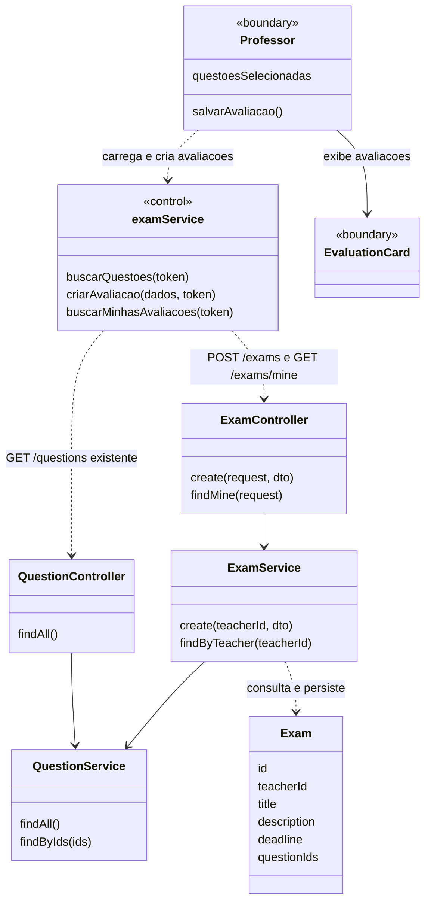
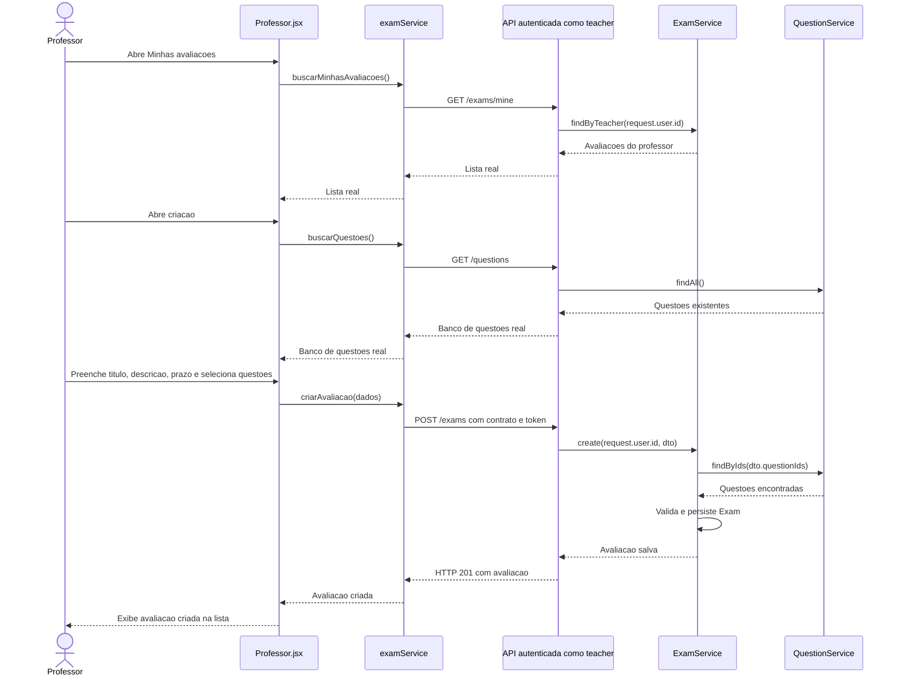

# 8. Criar avaliacao

**Ator:** professor (`teacher`). **Frontend:** somente web.

**Precondicao do fluxo real:** professor autenticado e ativo, com questoes
existentes disponiveis para selecao.

## Estado atual

Implementado e validado em 04/11/2026 com web, API e SQL Server no Docker.

| Parte | Status | Implementacao |
| --- | --- | --- |
| Web | Implementado | Carrega questoes reais, envia a criacao e lista avaliacoes persistidas do professor. |
| API | Implementado | `POST /exams` valida prazo futuro, campos obrigatorios e questoes existentes; o proprietario vem do JWT. |
| Listagem propria | Implementado | `GET /exams/mine`, restrito a professor, filtra `teacherId` e ordena por criacao decrescente, incluindo vencidas. |

O formulario usa titulo, descricao, prazo local (`datetime-local`) e IDs das
questoes selecionadas. O servico web converte o prazo para ISO e envia apenas
`title`, `description`, `deadline` e `questionIds`. Categoria, dificuldade,
avaliacoes fixas e contadores ficticios de tentativas foram removidos desse
fluxo. Nao houve nova tabela nem alteracao do contrato do desktop.

A tela apresenta carregamento, lista vazia, banco de questoes vazio, erro e
nova tentativa de carregamento. Salvar fica bloqueado durante o envio;
falhas preservam os campos e a selecao. Somente o sucesso do POST limpa o
formulario e inclui a resposta real na lista. Respostas 401/403 encerram a
sessao e direcionam ao login.

Resultados e desativacao estao indisponiveis nos cartoes: serao implementados
nos casos 9 e 10. Nao ha exclusao local fingindo remover um registro do banco.

### Validacao realizada

- 16 testes web e 36 testes backend passaram; builds dos dois apps aprovados.
- Criacao real pelo navegador, consulta por `GET /exams/mine` e persistencia
  apos recarga, incluindo formulario e lista em viewport movel.
- Prazo passado/invalido, campos em branco, questoes ausentes, UUID invalido,
  questao inexistente, IDs repetidos e `teacherId` no corpo rejeitados na API.
- Acesso anonimo e de aluno bloqueados; um segundo professor nao recebeu as
  avaliacoes do primeiro, mesmo enviando `teacherId` como parametro de consulta.
- Falha de rede preservou o formulario; erro de carregamento permitiu retry;
  banco de questoes vazio impediu envio. Esses erros foram provocados no navegador.
- Uma avaliacao demo foi mantida para `professor@eduquest.local`; o professor
  temporario usado no teste de isolamento foi desativado ao final.

O lint dos arquivos alterados passou. O lint geral da web ainda aponta o
erro preexistente de exportacao para Fast Refresh em `components/ui/button.jsx`.

## Planejamento original (historico)

O registro abaixo preserva a analise de 28/10/2026 e o desenho que orientou a
implementacao. As referencias a propostas e pendencias descrevem aquele
momento, nao o estado atual resumido acima.

| Parte | Status | O que tem |
| --- | --- | --- |
| Web | Parcial: demonstracao local | `Professor.jsx` possui formulario, selecao de questoes e cartoes, mas salva somente em `useState`, gerando ID com `Date.now()`. |
| API | Criacao implementada | `GET /questions` fornece o banco de questoes ao professor; `POST /exams` valida IDs e persiste a avaliacao vinculada ao professor autenticado. |
| Listagem propria | Nao implementada na API | `GET /exams` existente e exclusivo do aluno e retorna avaliacoes futuras, nao as avaliacoes do professor. |

O banco de questoes e a lista de avaliacoes da web sao fixos. O formulario tem
categoria e dificuldade, campos inexistentes em `Exam`, e nao tem o prazo que
a API exige. O login web e demonstrativo; nome/e-mail locais nao comprovam a
identidade do professor nem a propriedade das avaliacoes.

## O que precisa fazer

1. Conectar o login a `POST /auth/login`, enviar Bearer token e proteger a area
   do professor. O papel selecionado no formulario de login nao autoriza a API.
2. Carregar questoes reais por `GET /questions` e usar seus IDs na selecao.
3. Acrescentar prazo ao formulario e enviar o contrato real para `POST /exams`.
4. Criar consulta das avaliacoes do professor para a lista continuar correta ao
   recarregar a pagina, apoiando tambem os casos 9 e 10.
5. Remover os dados ficticios e tratar carregamento, erro e sessao sem permissao.

## Como fazer com o minimo de alteracao

### API

Manter a criacao existente em `ExamController.create` e `ExamService.create`.
O `teacherId` ja vem de `request.user.id`, nao do corpo. Enviar somente:

```json
{
  "title": "Fundamentos de programacao",
  "description": "Avaliacao de conceitos basicos",
  "deadline": "2030-12-31T23:59:59.000Z",
  "questionIds": ["uuid-de-uma-questao-existente"]
}
```

O UUID acima e ilustrativo e deve ser substituido pelo ID retornado pela API.
O DTO exige titulo/descricao nao vazios, data ISO e ao menos uma questao; o
servico verifica a existencia das questoes. Hoje a criacao nao exige prazo
futuro. Para evitar criar uma avaliacao ja indisponivel, validar prazo futuro
tambem no servidor, alem da validacao de preenchimento na tela.

**Adicionar (proposta):** `GET /exams/mine`, com guards e `@Roles('teacher')`,
chamando `ExamService.findByTeacher(request.user.id)`. Filtrar por `teacherId`
e ordenar por `createdAt` decrescente, incluindo vencidas e, apos o caso 10,
inativas. Declarar a rota estatica `mine` antes da rota proposta `:id` do caso
6 para nao confundir a palavra `mine` com um ID de avaliacao.

Retornar os dados de `Exam`, sem anexar todas as tentativas. Nao reaproveitar
o `GET /exams` de aluno alterando sua permissao ou misturando suas regras.

### Web

Reutilizar `Professor.jsx`, `components/EvaluationCard.jsx` e `examService.js`.
Acrescentar funcoes de buscar questoes, criar avaliacao e listar as proprias.
Usar `fetch`, como no servico existente. Incluir `/auth` e `/questions` no
proxy de `vite.config.js`; `/exams` ja esta encaminhado ao backend.

Usar um campo nativo `datetime-local` para prazo e converter a data/hora local
para ISO no envio. Adaptar `title`, `description`, `deadline`, `questionIds`
para o layout atual, contando questoes com `questionIds.length`. Ler questoes
por `prompt`, `options` e `correctOptionIndex`, ou mapear para os nomes atuais.
O gabarito pode permanecer na consulta restrita ao professor, nunca na consulta
do aluno proposta no caso 6.

Remover categoria/dificuldade e seus filtros ficticios: nao existem no banco.
Remover contadores globais de tentativas/notas dos mocks, em vez de inventar
valores ou carregar todas as tentativas para manter esses resumos. A consulta
por avaliacao sera tratada no caso 9; o cartao nao deve depender de
`tentativas.length` antes dela. Nao criar CRUD de questoes neste caso de uso.

Desabilitar salvar durante o envio; so informar sucesso e inserir a resposta
real na lista depois do POST bem-sucedido. Em falha, manter formulario e
selecao preenchidos. Nao enviar categoria, dificuldade, ID local ou `teacherId`:
a API rejeita campos extras e determina a identidade pelo token.

## UML do estado atual

`Professor` representa o componente React e `examService` o modulo JS, nao
novas classes a criar.
`<<boundary>>` representa uma interface React; `<<control>>`, a logica web que
coordena as chamadas a API.



## Diagrama de sequencia



## Verificacao de aceite

- Professor cria com questoes reais e prazo futuro; recarregar preserva a lista.
- A avaliacao recebe o `teacherId` autenticado, nunca um proprietario escolhido
  no navegador; outro professor nao a ve em Minhas avaliacoes.
- Titulo/descricao vazios, falta de questoes, ID inexistente e prazo invalido
  nao geram sucesso; prazo passado e rejeitado apos o ajuste proposto.
- Aluno e usuario sem sessao nao conseguem criar ou consultar a lista propria
  de professor; erro de rede preserva os dados preenchidos.

## Fontes

- `apps/web/src/pages/Professor.jsx:154-279`, `374-406`
- `apps/web/src/components/EvaluationCard.jsx`, `services/examService.js`, `vite.config.js`
- `apps/web/src/pages/auth/Login.jsx:19-32`, `src/main.jsx`
- `apps/server/src/exam/exam.controller.ts:15-30`, `exam.service.ts:16-35`
- `apps/server/src/exam/dto/create-exam.dto.ts`, `exam.entity.ts`
- `apps/server/src/question/question.controller.ts`, `question.service.ts`
