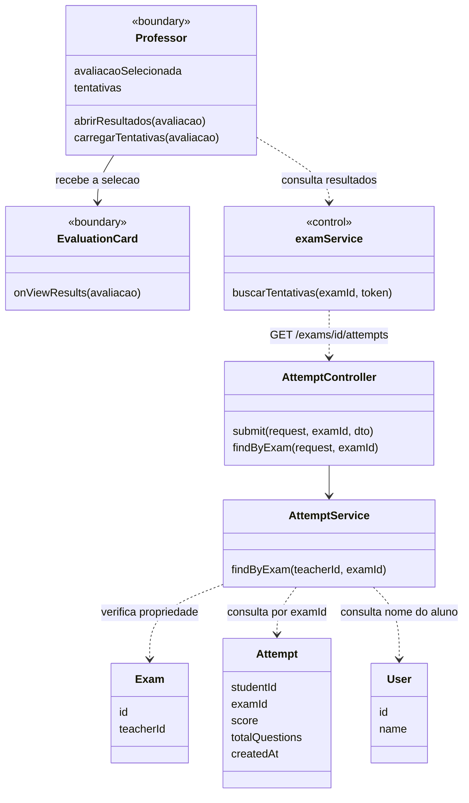
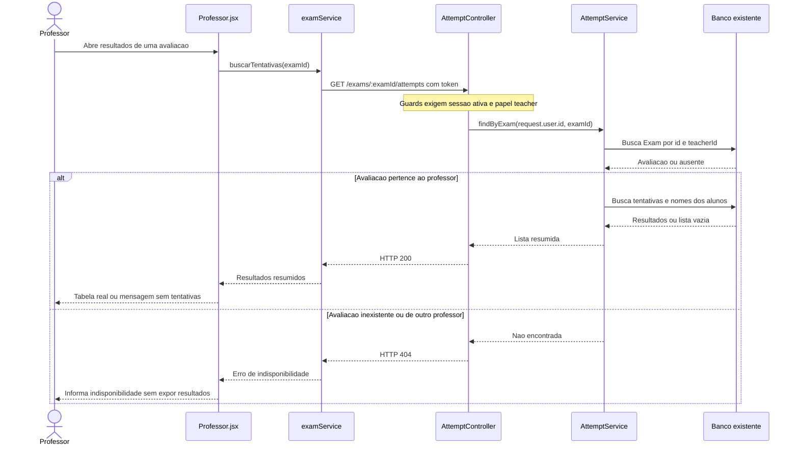

# 9. Checar tentativas dos alunos - Professor

**Atores:** professor (`teacher`). **Frontend:** somente web.

**Precondicao do fluxo real:** professor autenticado e ativo, consultando uma
avaliacao de sua autoria. A avaliacao pode estar vencida ou desativada.

## Estado atual

Implementado na web e API. Validado por testes unitarios, lint e build em
06/11/2026.

| Parte | Status | O que tem |
| --- | --- | --- |
| Web | Implementado | Professor abre os resultados de uma avaliacao e visualiza carregamento, erro, lista vazia ou tabela com aluno, acertos, nota e data. |
| API | Implementado | `GET /exams/:examId/attempts` exige professor, confirma que a avaliacao e de sua autoria e retorna resultados resumidos. |

`GET /leaderboard` e um ranking agregado e nao substitui esta consulta. A API
mantem um indice unico em `(studentId, examId)`, permitindo apenas uma tentativa
por aluno em cada avaliacao. A tela ignora respostas atrasadas ao trocar de
avaliacao e encerra a sessao em respostas 401 ou 403.

## Planejamento original (historico)

O registro abaixo descreve a demonstracao local existente antes da integracao.

## O que precisa fazer

1. Usar autenticacao e lista propria de avaliacoes propostas no [caso 8](08-criar-avaliacao-professor.md).
2. Expor consulta de tentativas somente para o professor proprietario da avaliacao.
3. Substituir a tabela fixa por resultados dessa consulta, com carregamento,
   erro, sessao nao autorizada e estado sem tentativas.
4. Adaptar notas e datas aos campos reais e remover a simulacao de varias
   tentativas por aluno.

## Como fazer com o minimo de alteracao

### API

**Adicionar (proposta):** `GET /exams/:examId/attempts` no `AttemptController`
existente, com `JwtAuthGuard`, `RolesGuard` e `@Roles('teacher')`. O POST na
mesma rota continua exclusivo do aluno, sem alteracao em seu contrato.

Adicionar `AttemptService.findByExam(teacherId, examId)`. Primeiro consultar
`Exam` por `{ id: examId, teacherId }`, usando `request.user.id` como professor.
Se nao existir ou pertencer a outro professor, responder 404. Apenas verificar
`@Roles('teacher')` nao protege contra consultar dados de outro professor.

Depois consultar tentativas por `examId`, juntar nome do aluno em `users` e
ordenar por `createdAt` decrescente. O servico ja possui repositorios de
`Attempt` e `Exam`; a consulta de ranking ja demonstra join com `users`.
Retornar somente `id`, `examId`, `studentId`, `studentName`, `score`,
`totalQuestions` e `createdAt`, sem hash, e-mail, gabarito ou respostas completas.

Sem tentativas, retornar HTTP 200 com `[]`. Nao filtrar prazo, status da
avaliacao ou status atual do aluno: resultados antigos devem ser preservados.
Nao criar tabela, endpoint de ranking novo ou servico separado de relatorios.

### Web

Acrescentar `buscarTentativas(examId, token)` a `examService.js` e carregar ao
abrir os resultados. Reutilizar a tabela de `Professor.jsx`; se a selecao mudar
durante a consulta, ignorar/cancelar a resposta anterior para nao mostrar dados
de uma avaliacao sob o titulo de outra. As rotas usam o proxy `/exams` existente.

Mapear `studentName` para aluno e formatar `createdAt`. `score` e quantidade
de acertos: para manter nota de 0 a 10, calcular apenas na exibicao
`totalQuestions > 0 ? score / totalQuestions * 10 : 0`. Os pontos do ranking
continuam sendo 10 por acerto; nao persistir outra nota.

Remover a coluna de numero de tentativa e usar a quantidade e a media dos
resultados realmente carregados para a avaliacao selecionada. Nao mostrar
resumos globais ficticios nem buscar resultados de todas as avaliacoes so para
mante-los. O escopo e consultar resultados por avaliacao, nao revisar cada
resposta, exportar planilha ou permitir novas tentativas.

## UML do estado atual

`Professor` e componente React e `examService` e modulo JS.
`<<boundary>>` representa uma interface React; `<<control>>`, a logica web que
coordena as chamadas a API.

## Diagrama de sequencia

## Verificacao de aceite

- Professor consulta resultados somente das proprias avaliacoes; alterar
  `examId` na chamada nao permite acessar as de outro professor.
- Tentativa real do aluno aparece com nome, data e nota corretos; 3 acertos em
  4 questoes exibem 7,5, nao 3 nem 30 como nota.
- Avaliacao propria sem respostas retorna lista vazia, nao dados demonstrativos.
- Avaliacao vencida ou desativada e aluno posteriormente inativo nao apagam nem
  ocultam os resultados salvos.
- Aluno e usuario sem sessao nao acessam o GET do professor; erro de rede e
  apresentado como erro, nao como ausencia de tentativas.

## Fontes

- `apps/web/src/pages/Professor.jsx:154-182`, `204-208`, `415-441`
- `apps/web/src/components/EvaluationCard.jsx:41-80`
- `apps/server/src/attempt/attempt.controller.ts:10-27`, `attempt.service.ts:13-46`
- `apps/server/src/attempt/attempt.entity.ts`, `exam/exam.entity.ts`
- `apps/server/src/auth/jwt-auth.guard.ts`, `roles.guard.ts`
