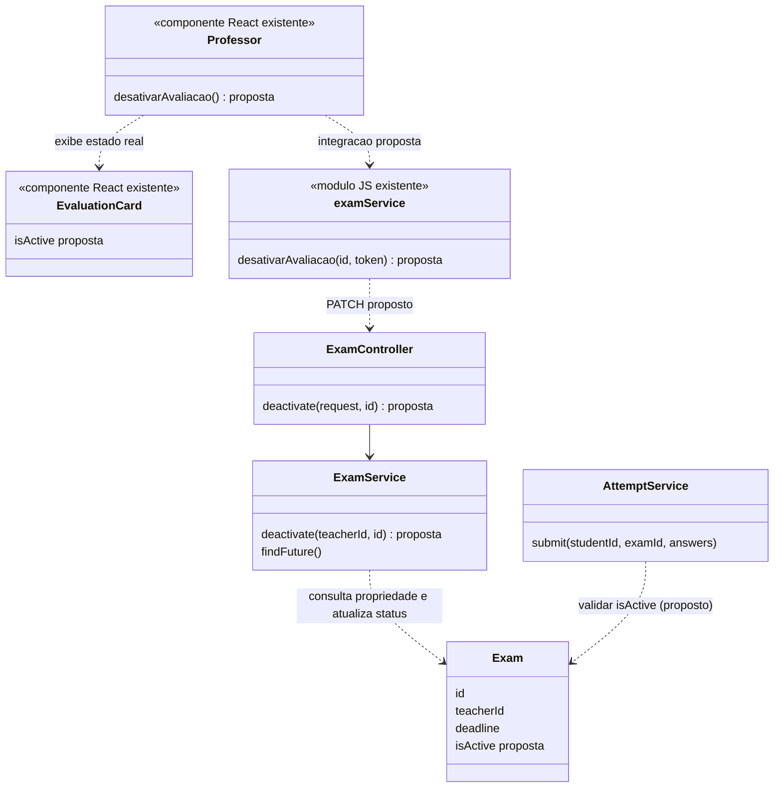
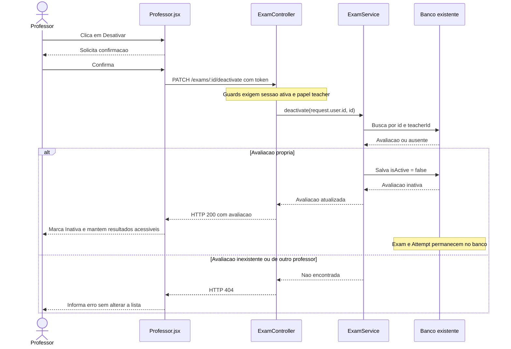

# 10. Desativar avaliacao

**Ator:** professor (`teacher`). **Frontend:** somente web.

**Precondicao do fluxo real:** professor autenticado e ativo, selecionando uma
avaliacao de sua autoria.

## Estado atual

Analise estatica do codigo em 28/10/2026; aplicacao e banco nao executados.

| Parte | Status | O que tem |
| --- | --- | --- |
| Web | Desativacao nao implementada | Existe botao Excluir e confirmacao, mas apenas removem a avaliacao do estado local, sem chamada a API. |
| API | Nao implementada | `Exam` nao possui status ativo e `ExamController` so oferece criacao e listagem de avaliacoes futuras. |

Excluir um item da tela nao e desativar. Hoje o backend bloqueia envio por
prazo vencido, inexistencia ou tentativa repetida; nao verifica desativacao.
Avaliacoes e tentativas reais nao sao alteradas pelo botao atual da web.

### UML de sequencia atual (web)

```mermaid
sequenceDiagram
    actor Professor
    participant Tela as Professor.jsx
    Professor->>Tela: Clica em Excluir
    Tela-->>Professor: Exibe confirmacao de exclusao
    Professor->>Tela: Confirma
    Tela->>Tela: Filtra avaliacoes no estado React
    Tela-->>Professor: Item deixa de aparecer
    Note over Tela: Sem API e sem persistencia; nao ha desativacao
```

## O que precisa fazer

1. Reutilizar autenticacao e lista propria do [caso 8](08-criar-avaliacao.md).
2. Guardar disponibilidade ativa/inativa em `Exam` e oferecer uma operacao
   exclusiva do professor proprietario, sem excluir avaliacao nem tentativas.
3. Trocar Excluir por Desativar na interface, manter confirmacao e mostrar o
   status real apos sucesso.
4. Bloquear avaliacoes inativas na listagem, consulta de conteudo e envio do
   aluno. Ocultar somente o cartao no navegador nao e protecao suficiente.
5. Preservar consultas de tentativas e historico, inclusive de inativas.

## Como fazer com o minimo de alteracao

### API e banco

Adicionar somente `Exam.isActive`, booleano com padrao `true`. Avaliacoes novas
e registros existentes devem iniciar ativos. Esse caso exige uma coluna nova,
nao uma tabela. Atualizar o esquema conforme a configuracao do projeto:
`app.module.ts` usa `synchronize` apenas em desenvolvimento. Fora dele, aplicar
a alteracao de esquema com valor padrao e preenchimento dos registros existentes
antes de usar o novo campo; nao habilitar sincronizacao destrutiva por conveniencia.

**Adicionar (proposta):** `PATCH /exams/:id/deactivate` em `ExamController`, com
guards e `@Roles('teacher')`, chamando `ExamService.deactivate(teacherId, id)`.
Buscar por `{ id, teacherId: request.user.id }`; ausente ou de outro professor
retorna 404. Atualizar somente `isActive = false` e devolver a avaliacao.
Repetir a operacao deve manter o estado inativo sem erro de duplicidade.

Nao receber `teacherId` do corpo, nao excluir `Exam`/`Attempt` e nao alterar o
prazo para simular desativacao: prazo e disponibilidade sao conceitos distintos.

Alterar os pontos existentes e propostos de acesso do aluno:

| Ponto | Ajuste necessario |
| --- | --- |
| `ExamService.findFuture` existente (`GET /exams`) | Exigir prazo futuro e `isActive = true`. |
| `ExamService.findForStudent` proposto no caso 6 | Rejeitar avaliacao inativa, alem de inexistente ou vencida; continuar sem expor gabarito. |
| `AttemptService.submit` existente | Rejeitar avaliacao inativa na validacao do servidor, mesmo se a tela tiver sido aberta antes. |
| `findByTeacher` proposto no caso 8 | Incluir ativas e inativas na lista do proprietario. |
| Consultas propostas nos casos 7 e 9 | Nao filtrar `isActive`; resultados continuam consultaveis. |

A verificacao de disponibilidade vale no momento da validacao do envio. Uma
tentativa que ja passou dessa validacao pode terminar enquanto ocorre a
desativacao; esta proposta nao promete cancelar requisicoes em andamento. Se
o trabalho exigir bloqueio atomico entre envio e desativacao, serializar ambas
as operacoes sobre a mesma avaliacao em transacao no banco, nao com lock global
em memoria. Essa garantia adicional nao e necessaria para o fluxo sequencial
de demonstracao aqui descrito.

### Web

Reutilizar `Professor.jsx`, `EvaluationCard` e o modal existente, trocando nomes
e mensagens de exclusao para desativacao. Acrescentar
`desativarAvaliacao(id, token)` ao `examService.js`; o proxy `/exams` ja cobre
a rota proposta. Usar a resposta real para atualizar o item, sem remove-lo da
lista. Mostrar Inativa, desabilitar Desativar e manter acesso a Ver resultados.

Durante o envio, bloquear nova confirmacao. Em falha, preservar o item e
informar erro; cancelar o modal nao faz chamada nem altera o estado. Nao criar
nova pagina, reativacao, exclusao permanente ou tabela de arquivamento.

### UML de classes do fluxo alvo

Os componentes e classes ja existem. O campo e os metodos marcados sao
propostos; `Professor` e `examService` sao representacoes logicas do frontend.



### UML de sequencia do fluxo alvo (proposto)



## Verificacao de aceite

- Cancelar nao muda o registro; confirmar persiste Inativa, inclusive ao
  recarregar. Repetir a chamada continua seguro e preserva os resultados.
- Professor nao desativa avaliacao de outro, mesmo alterando o ID na API;
  aluno e usuario sem sessao nao conseguem executar a operacao.
- Depois de desativada, avaliacao nao aparece na lista disponivel ao aluno;
  consulta direta de conteudo e novo envio de respostas sao rejeitados.
- Aluno que abriu a tela antes, mas envia apos a desativacao confirmada, recebe
  erro; tentativas salvas antes continuam no historico e na consulta do professor.
- Erro de rede nao remove a avaliacao localmente nem exibe falso sucesso.

## Fontes

- `apps/web/src/pages/Professor.jsx:227-236`, `518-525`
- `apps/web/src/components/EvaluationCard.jsx:74-80`
- `apps/server/src/exam/exam.entity.ts`, `exam.controller.ts`, `exam.service.ts:33-35`
- `apps/server/src/attempt/attempt.service.ts:14-24`, `attempt.entity.ts`
- `apps/server/src/app.module.ts:13-22`
- [Fazer avaliacao](06-fazer-avaliacao.md), [Consultar avaliacoes realizadas](07-consultar-avaliacoes-realizadas.md)
