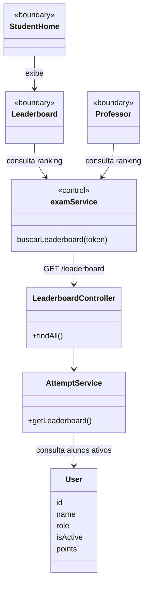
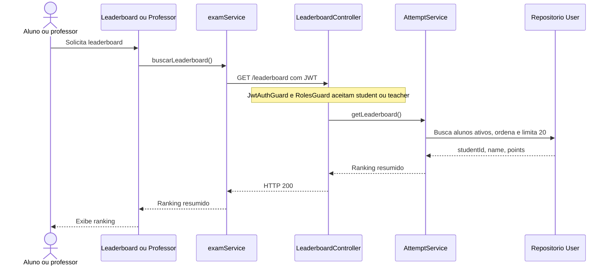

# 11. Consultar leaderboard - Aluno e professor

**Atores:** aluno (`student`) e professor (`teacher`). **Frontend:** web.

## Estado atual

| Parte | Status | Implementacao |
| --- | --- | --- |
| API | Implementado | `GET /leaderboard` exige sessao ativa de aluno ou professor e retorna os 20 alunos ativos com maior pontuacao. |
| Web do aluno | Implementado | `Leaderboard` consulta a API e trata carregamento, lista vazia, erro e sessao nao autorizada. |
| Web do professor | Implementado | A aba Leaderboard consulta a mesma API e trata carregamento, lista vazia, erro e sessao nao autorizada. |

O ranking e ordenado por pontos decrescentes, nome crescente e ID crescente.
Retorna apenas `studentId`, `name` e `points`; nao expoe e-mail, senha, tentativas
ou gabarito. A pontuacao e acumulada quando o aluno envia uma tentativa valida.

## UML do estado atual

`<<boundary>>` representa uma interface React; `<<control>>`, o modulo web que
coordena a chamada autenticada a API.

## Diagrama de sequencia

## Fontes

- `apps/server/src/attempt/attempt.controller.ts`
- `apps/server/src/attempt/attempt.service.ts`
- `apps/web/src/components/student/Leaderboard.jsx`
- `apps/web/src/pages/student/StudentHome.jsx`
- `apps/web/src/pages/Professor.jsx`
