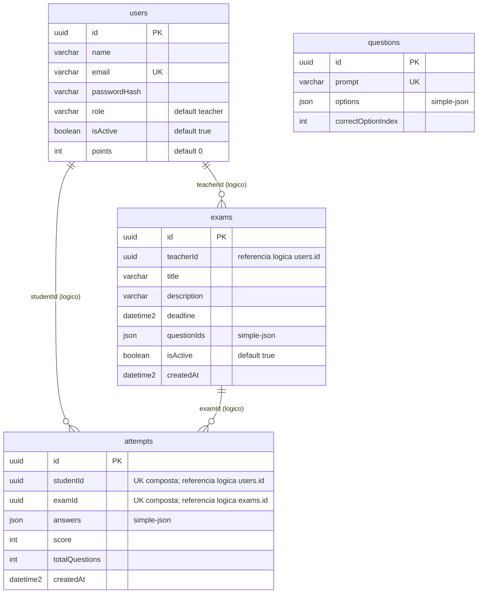

# DER - EduQuest

Modelo relacional derivado das entidades TypeORM atuais em `apps/server/src`.

## Restricoes fisicas

| Tabela | Restricao |
| --- | --- |
| `users` | PK `id`; UNIQUE `email` |
| `questions` | PK `id`; UNIQUE `prompt` |
| `exams` | PK `id` |
| `attempts` | PK `id`; UNIQUE composto (`studentId`, `examId`) |

A `UNIQUE` de `attempts` e uma unica restricao composta, nao duas restricoes
independentes. Ela permite somente uma tentativa de cada aluno por avaliacao.

## Estrutura de `answers`

`attempts.answers` e JSON, mapeado pela entidade como `simple-json`, contendo
uma lista de objetos no formato `[{ questionId, selectedOptionIndex }]`.
`questionId` identifica a questao respondida e `selectedOptionIndex` identifica
a opcao selecionada para essa mesma questao.

`teacherId`, `studentId` e `examId` sao colunas UUID usadas como referencias
logicas pela aplicacao. As entidades TypeORM nao declaram `@ManyToOne` ou
`@JoinColumn`; portanto, o esquema atual nao cria chaves estrangeiras SQL para
essas colunas. `questionIds` tambem e mapeado como `simple-json`.
