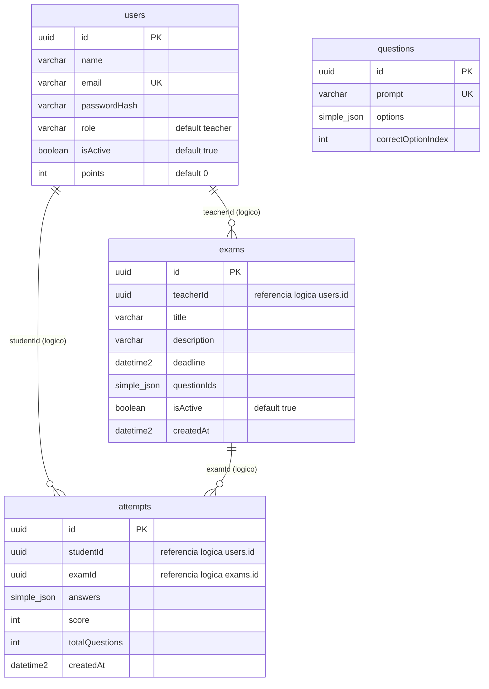

# DER - EduQuest

Modelo fisico derivado das entidades TypeORM atuais em `apps/server/src`.

## Restricoes fisicas

| Tabela | Restricao |
| --- | --- |
| `users` | PK `id`; UNIQUE `email` |
| `questions` | PK `id`; UNIQUE `prompt` |
| `exams` | PK `id` |
| `attempts` | PK `id`; UNIQUE composto (`studentId`, `examId`) |

`teacherId`, `studentId` e `examId` sao colunas UUID usadas como referencias
logicas pela aplicacao. As entidades TypeORM nao declaram `@ManyToOne` ou
`@JoinColumn`; portanto, o esquema atual nao cria chaves estrangeiras SQL para
essas colunas. `questionIds` e `answers` sao colunas `simple-json`.
