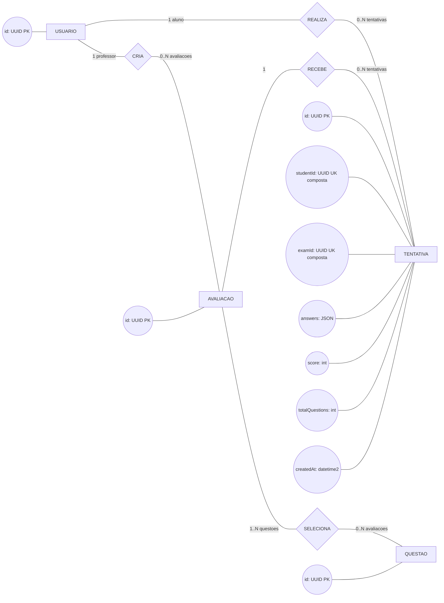

# MER - EduQuest

Modelo conceitual do estado atual. `admin`, `teacher` e `student` sao papeis
do atributo `role` de `USUARIO`, nao entidades separadas.

**Legenda:** retangulos representam entidades, losangos representam
relacionamentos e elipses representam atributos. `PK` identifica chave primaria
e `UK composta` identifica os campos que formam uma chave unica composta.
O diagrama mostra somente os atributos principais para leitura e captura em
documento; o DER contem a relacao completa de colunas.

## Regras do dominio

- Um usuario professor pode criar nenhuma ou varias avaliacoes; cada avaliacao
  e criada por um professor.
- Um usuario aluno pode realizar nenhuma ou varias tentativas; cada tentativa e
  realizada por um aluno.
- Uma avaliacao pode receber varias tentativas, mas cada tentativa pertence a
  uma avaliacao.
- A combinacao `studentId + examId` e uma `UK` composta. Assim, cada aluno pode
  possuir apenas uma tentativa por avaliacao.
- Uma avaliacao seleciona uma ou mais questoes; uma questao pode compor varias
  avaliacoes.
- Avaliacao inativa preserva tentativas e deixa de estar disponivel para novos
  alunos.

## Estrutura de `answers`

`answers` e um JSON contendo uma lista de objetos no formato
`[{ questionId, selectedOptionIndex }]`. Cada objeto associa `questionId` da
questao respondida ao indice `selectedOptionIndex` da opcao selecionada para
essa questao.

## Observacao de implementacao

O relacionamento `AVALIACAO`--`QUESTAO` e conceitual. No banco atual, os IDs
das questoes ficam no campo JSON `questionIds` de `exams`; nao existe tabela
associativa. As respostas de uma tentativa tambem ficam no JSON `answers`.
