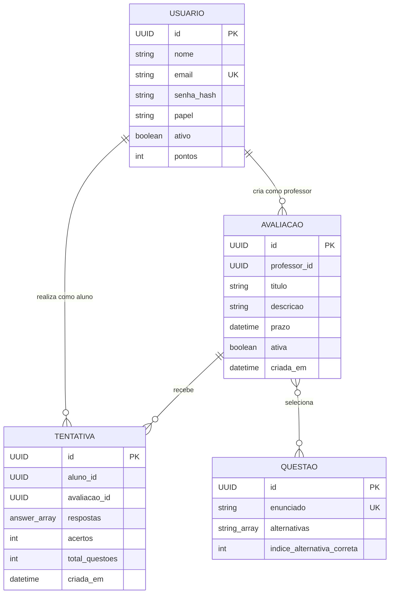

# MER - EduQuest

Modelo conceitual do estado atual. `admin`, `teacher` e `student` sao papeis
da entidade `USUARIO`, nao entidades separadas.

## Regras do dominio

- Um usuario professor pode criar nenhuma ou varias avaliacoes.
- Um usuario aluno pode realizar nenhuma ou varias tentativas.
- Uma avaliacao pode receber varias tentativas, uma por aluno.
- A combinacao `aluno_id + avaliacao_id` e unica.
- Uma avaliacao seleciona uma ou mais questoes; uma questao pode compor varias
  avaliacoes.
- Avaliacao inativa preserva tentativas e deixa de estar disponivel para novos
  alunos.

## Observacao de implementacao

O relacionamento `AVALIACAO`--`QUESTAO` e conceitual. No banco atual, os IDs
das questoes ficam no campo JSON `questionIds` de `exams`; nao existe tabela
associativa. As respostas de uma tentativa tambem ficam no JSON `answers`.
