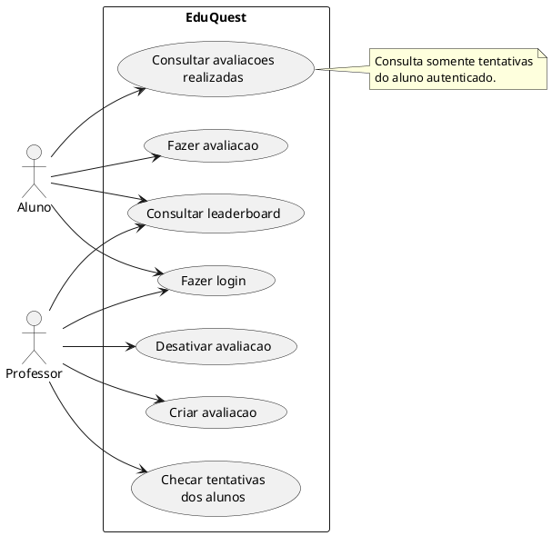

# Casos de Uso - Web

O diagrama registra os casos de uso web implementados. O destaque e a consulta
do proprio historico de avaliacoes realizadas pelo aluno.

O detalhamento tecnico desse caso esta em
[`07-consultar-avaliacoes-realizadas-aluno.md`](../07-consultar-avaliacoes-realizadas-aluno.md).
O leaderboard esta documentado em
[`11-consultar-leaderboard-aluno-professor.md`](../11-consultar-leaderboard-aluno-professor.md).
